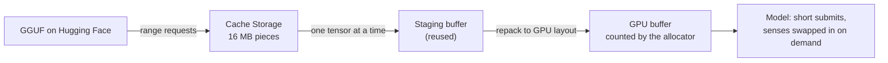

<h1 align="center">Tilde~Engine</h1>

<p align="center">A WebGPU engine that runs small language models in a browser tab, built to survive iPhone Safari.</p>

<p align="center"><a href="#quick-start">Quick start</a> · <a href="docs/design.md">Design doc</a> · <a href="bench/">Benchmarks and checks</a></p>

A phone's browser tab is a hostile place for a 1 GB model. iOS gives the whole tab about **1.9 GB**, shared by
JavaScript, WebAssembly and every GPU buffer, and kills it (Jetsam) the moment it goes over
([measured on an iPhone 16](https://github.com/KealJones/lm-experiments/blob/main/experiments/memcap/README.md); WebKit's engineers on
the OS limit: [bug 268816](https://bugs.webkit.org/show_bug.cgi?id=268816)). WebKit drops the GPU if one command buffer
runs past about **3 seconds** ([WebKit's watchdog](https://github.com/WebKit/WebKit/blob/main/Source/WebGPU/WebGPU/Queue.mm#L492-L494),
which logs "did not complete within 3s timeout"; the same crash in
[onnxruntime#33753](https://github.com/microsoft/onnxruntime/issues/33753)). Most browser runtimes hope to stay under
those lines. Tilde is built around them.

The `~` is for the limits it lives under, which only ever come approximately: ~1.9 GB, ~3 s.

## What it gets you

Measured on an iPhone 16 in Safari 27.2 with Liquid AI's LFM3 1.7B (QAD Q4_0), Nov 19, 2026
([runs](docs/runs/2026-11-19-iphone16-lfm3-kernels.md)). The same engine runs LFM3 Omni 2B with every sense (pictures,
video with its sound, audio in, its own voice out) and Qwen3 0.6B; see [Models](#models).

| Measure | LFM3 1.7B |
|---|---|
| Prompt reading | **139–157 tok/s** (64- or 256-token chunks) |
| Writing | **12.3 tok/s** |
| Memory the engine holds | **1,065–1,092 MB** at a 4K context, every byte counted |
| Load from cache | **~4–6 s** |
| Matches llama.cpp | same top 5 and **12/12 identical greedy tokens** on the same prompt |

- **Never holds the whole file.** Weights arrive by HTTP range request, tensor by tensor, get repacked into the GPU
  layout in one small reused staging buffer, and are dropped. Peak memory while loading is the GPU weights so far plus
  one staging buffer, not the file twice.
- **Counts every byte.** All GPU memory goes through one allocator with a running total, so the engine can tell you
  what it holds and refuse a load that wouldn't fit instead of getting the tab killed.
- **Never trips the GPU watchdog.** Work is split into short submits sized ahead of time from per-batch-size
  measurements, so a long prompt never becomes one 4-second command buffer.
- **Swaps senses in and out.** With LFM3 Omni 2B the backbone stays resident and the vision encoder, audio encoder and
  speech generator each load when needed and free after. Peak is the backbone plus the largest sense (~1.3 GB of
  weights) instead of everything at once (~1.6 GB), which is what crashed Liquid's own WebGPU demo on an iPhone at
  ~80% loaded.
- **Sees, hears and speaks.** Pictures, video with its soundtrack, audio in, and the model's own voice out, all on
  the GPU. Vision on a 256×256 test image matches llama.cpp's first 8 greedy tokens.
- **Doesn't reread the conversation.** A new prompt that starts with what the model already read picks up where it
  left off, and snapshots let it reuse the prompt even when a chat template rewrites the last turn.
- **Downloads once.** Files are kept in Cache Storage in 16 MB pieces, resumable, so the second visit loads in
  seconds with no network.
- **Reads official GGUFs directly.** No conversion step and no extra hosting: point it at Liquid's file on Hugging
  Face.
- **Runs without WebGPU too.** Where the browser has none (Firefox on Android, a blocklisted GPU), the same model code
  runs on the CPU in WebAssembly SIMD, text only, matching llama.cpp's tokens. Slower, but it answers instead of
  failing. [How](docs/design.md#cpu-backend).
- **No build step, no `shader-f16` required.** Plain ES modules with JSDoc types. Import it from jsDelivr or serve it
  from GitHub Pages as-is.



## Next to the other runtimes

LFM3 1.7B on one iPhone 16, Safari 27.2, from [bench/compare.html](bench/compare.html): each runtime in a fresh page,
same text, 64 tokens written. Speeds in tokens per second (read / write); one run per cell. The first three rows ran
on Nov 19 with Tilde and WebLLM taking turns ([paced](docs/runs/2026-11-19-iphone16-lfm3-vs-webllm-paced.md),
[stock](docs/runs/2026-11-19-iphone16-lfm3-vs-webllm.md)); the rest are from Nov 18. Details and caveats are in [docs/compared.md](docs/compared.md); why each one breaks, with
diagrams, is in [docs/versus.md](docs/versus.md).

| Runtime | 256-token prompt | 1,024 | 3,072 |
|---|---|---|---|
| **Tilde**, 256-token chunks (Nov 19) | ✅ 155.4 / 12.3 | ✅ 156.3 / 12.0 | ✅ 141 / 10.7 |
| **WebLLM** (our MLC build) + Squiggle's pacing (Nov 19) | ✅ 99 / 12.5 | ✅ 95.7 / 11.8 | ✅ 80.4 / 10.2 |
| **WebLLM** (our MLC build), stock (Nov 19) | ✅ 102.5 / 12.7 | 💀 killed while loading | – |
| **wllama 3.13** WebGPU | 💀 killed while loading | – | – |
| **wllama 3.13** CPU | ✅ 1.8 / 1.4 | ✅ 1.6 / 1.6 (10.8 min to first token) | ⏱ timed out at 25 min |
| **transformers.js 4.4** | 💀 killed while loading | – | – |
| **LiteRT-LM 0.19** | 💀 killed while loading | – | – |

Since its Nov 19 kernel rewrite, Tilde reads LFM3 prompts 1.6–1.75× faster than WebLLM with Squiggle's pacing (the
WebLLM setup that survives long prompts), reaches the first token sooner (21.8 s against 38.2 s at 3,072 tokens) and
writes about as fast. WebLLM loads faster and in ~50 MB less memory. On Nov 18, before the rewrite, Tilde read at 35–50
tok/s and paced WebLLM was the faster one. ([All of Tilde's Nov 19 runs](docs/runs/2026-11-19-iphone16-lfm3-kernels.md).)

With Qwen3 0.6B (Nov 19, [details](docs/compared.md#qwen3-06b-one-phone-two-passes-nov-19-2026)): Tilde again
finished every prompt size, in the least memory (865 MB against WebLLM's 1,125 and LiteRT-LM's 1,496). After that
day's kernel rewrite Tilde reads prompts faster than WebLLM (322 tok/s at 256 tokens against 215; 268 at 1,024
against paced WebLLM's 205). LiteRT-LM is still the fastest where it ran, reading 1.5–3× faster than Tilde, but it,
stock WebLLM and paced WebLLM all lost the GPU on a longer prompt.

Tilde isn't the fastest at everything: WebLLM loads faster and in a little less memory, and where LiteRT-LM runs it
reads prompts faster still. Tilde is the only one that finished every prompt size on both models without patches, and
it stays up on iOS 27, needs no compile jobs, reads Liquid's official GGUFs as they are and swaps senses in and out.

## Quick start

```js
import { Tilde } from 'https://cdn.jsdelivr.net/gh/KealJones/tilde@a7234e4/src/index.js';

const llm = await Tilde.load(
  'https://huggingface.co/LiquidAI/LFM3-1.7B-GGUF/resolve/main/LFM3-1.7B-QAD-Q4_0.gguf',
  { onProgress: ({ loaded, total }) => console.log(`${Math.round((100 * loaded) / total)}%`) },
);

await llm.chat([{ role: 'user', content: 'Hi! Who are you?' }], {
  onToken: (t) => (out.textContent += t),
});

console.log(llm.stats()); // what the engine holds on the GPU
```

Without WebGPU, `Tilde.load` runs on the CPU instead (`llm.backend === 'cpu'`, text only). Pass `backend: 'gpu'` to
fail rather than fall back, or `backend: 'cpu'` (or add `?tilde-backend=cpu` to the page's URL) to try the CPU path.

For the multimodal model, pass the encoder file as `mmproj`; each sense loads only when it's used:

```js
const omni = await Tilde.load(
  'https://huggingface.co/LiquidAI/LFM3-Omni-2B-GGUF/resolve/main/LFM3-Omni-2B-Q4_0.gguf',
  { mmproj: 'https://huggingface.co/LiquidAI/LFM3-Omni-2B-GGUF/resolve/main/mmproj-LFM3-Omni-2B-Q8_0.gguf' },
);

const bitmap = await createImageBitmap(file);
await omni.chat([{ role: 'user', content: [{ type: 'image', image: bitmap }, 'What is in this picture?'] }]);
const pcm = await omni.speak('Hello from inside a browser tab.'); // 24 kHz mono, streamed via onAudio
const words = await omni.transcribe(micPcm);                       // 16 kHz mono in
```

The [demo page](demo/index.html) does all of this with a model picker, photo and video input and a microphone
button. Run it locally with `node bench/server.mjs` and open `http://localhost:8790/demo/` (WebGPU needs localhost or
HTTPS).

## Models

- [LFM3 1.7B](https://huggingface.co/LiquidAI/LFM3-1.7B-GGUF) (Liquid AI): text, thinking, chat.
- [LFM3 Omni 2B](https://huggingface.co/LiquidAI/LFM3-Omni-2B-GGUF): text, pictures, video with its sound, audio in
  and its own voice out.
- [Qwen3 0.6B](https://huggingface.co/ggml-org/Qwen3-0.6B-GGUF) (and other dense Qwen3 sizes with 128-wide heads):
  text, from a Q4_0 GGUF. 631 MB on the GPU at a 4K context; same top 5 as llama.cpp and 8/8 identical greedy tokens.

Model code lives in one file per architecture (`src/models/`), picked from the GGUF's `general.architecture` and
imported only when a model of that kind loads, so adding another costs pages that don't use it nothing.

## How it's checked

- `npm test`: GGUF parsing, quant repacking and the CPU reference math.
- `npm run gpu-test`: every kernel in headless Chrome on SwiftShader WebGPU, compared with the CPU reference and with
  llama.cpp's logits for the same tokens.
- Real iPhones, driven remotely through [phone-relay](https://github.com/KealJones/phone-relay), for load, memory and
  speed runs. The pages are in [`bench/`](bench/).

## Used by

[Squiggle](https://github.com/KealJones/squiggle), an AI agent that runs entirely in the browser, loads Tilde
straight from this repo, pinned by commit (landing in [squiggle#22](https://github.com/KealJones/squiggle/pull/22)).

## Status

Version 0.1.0 and moving fast. Next up: faster decode kernels (a decode step is now almost all GPU time, reading
weights at about 13 GB/s) and an English-only vocabulary trim that would take about 160 MB off the token table, adopted
only if it measures well. The [design doc](docs/design.md) has the full reasoning and every number above.

## License

MIT for the code. Model weights have their own licenses (LFM3: LFM Open License v1.0; Qwen3: Apache 2.0).
