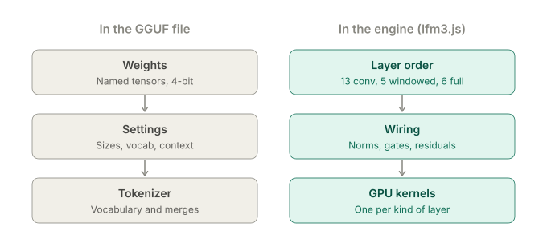
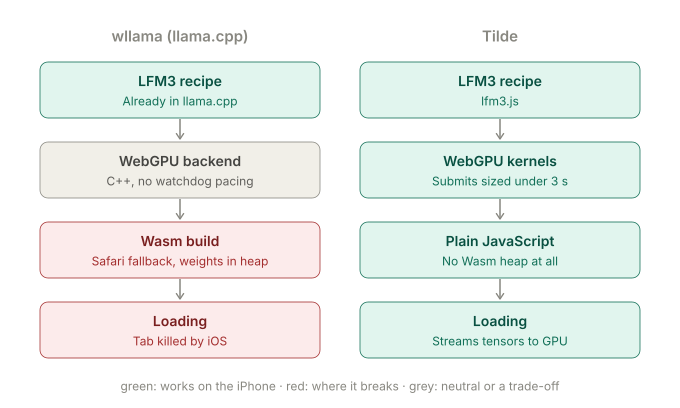
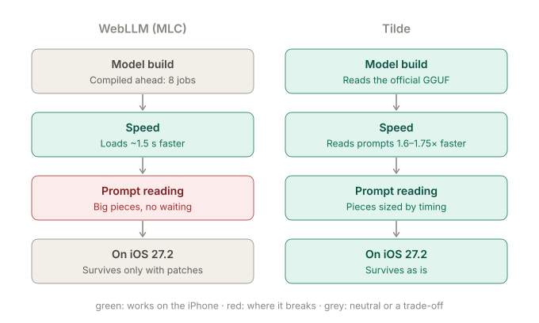
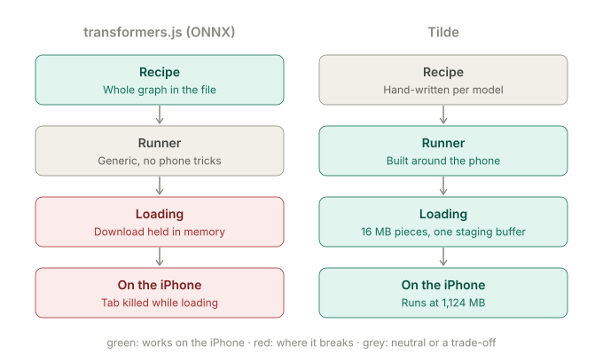
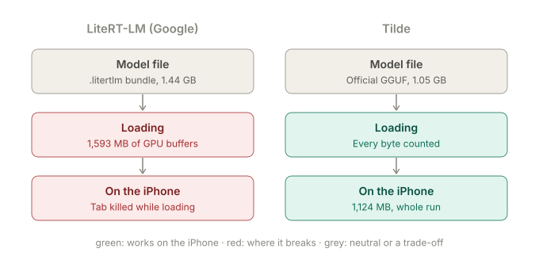

# Tilde versus the other browser runtimes, explained

The [numbers](compared.md) say who survived the iPhone. These diagrams say why. Each one puts a runtime next to
Tilde, layer by layer, and marks where it breaks on an iPhone 16 in Safari 27.2 (~1.9 GB per tab, shared by
JavaScript, WebAssembly and the GPU; ~3 s per GPU command buffer).

- [What a model file holds](#what-a-model-file-holds-and-what-the-engine-has-to-know)
- [wllama (llama.cpp)](#wllama-the-recipe-is-there-the-stack-underneath-isnt)
- [WebLLM (MLC)](#webllm-quick-to-load-until-ios-27-stops-it)
- [transformers.js (ONNX)](#transformersjs-the-generic-runner)
- [LiteRT-LM (Google)](#litert-lm-the-fastest-until-the-prompt-gets-long)

## What a model file holds, and what the engine has to know

A GGUF holds the weights, a few settings and the tokenizer. It doesn't say how to run them: that LFM3's 24 layers
are 13 short convolutions, 5 windowed attention and 6 full attention, where the norms sit, or which gate goes where.
Every engine that reads GGUFs keeps that recipe as code, one file per architecture: llama.cpp has `lfm3.cpp`, Tilde
has [`src/models/lfm3.js`](../src/models/lfm3.js). ONNX is the exception: it ships the whole computation as a graph,
so any ONNX runner can run any model, at the price of running it generically.

## wllama: the recipe is there, the stack underneath isn't

llama.cpp already knows LFM3, so writing another model adapter for wllama wouldn't help. It breaks lower down:

- **The Wasm build.** Safari 27.2 can't compile wllama's default build ("Memory64 is not enabled"), so it has to use
  its slower Safari build, and the weights pass through WebAssembly memory on their way to the GPU.
- **The GPU backend.** llama.cpp's WebGPU backend is generic C++ with no idea of WebKit's 3-second limit.
- **Result:** the tab was killed while loading, every time ([run](runs/2026-11-18-iphone16-lfm3.md),
  [earlier crash loop](compared.md#earlier-results-by-runtime)). On the CPU it survives, at 1.4–1.8 tokens a second
  and 10.8 minutes to the first token for a 1,024-token prompt.

Fixing that means changing llama.cpp's WebGPU backend and maintaining a custom Wasm build: possible, but the work is
in a large C++ codebase whose design fights the phone.

## WebLLM: quick to load, until iOS 27 stops it

WebLLM loads faster than Tilde (about 4 s against 5.6 s) and in ~50 MB less memory. On Nov 18 it also read prompts
1.5–1.9× faster ([run](runs/2026-11-18-iphone16-lfm3.md)); since Tilde's Nov 19 kernel rewrite that has flipped, and
Tilde reads 1.57–1.75× faster than paced WebLLM at every prompt size
([run](runs/2026-11-19-iphone16-lfm3-vs-webllm-paced.md)). Its weak spot is how it feeds the GPU:

- **Big pieces, no waiting.** It queues 256-token prompt pieces back to back, ~2.5 s each on the iPhone, and Safari
  27.2.1 kills the GPU when a command buffer waits more than 3 s. It survives only with Squiggle's patch, which
  reaches into WebLLM's internals to cut the pieces and wait after each one
  ([what WebLLM needed](compared.md#what-webllm-needed-to-survive-ios-27)).
- **Compiled ahead.** WebLLM had no LFM3 build; making one took eight compile jobs. Tilde reads Liquid's official GGUF.
- **Tilde's side:** it times every submit and sizes the next one to stay well under the limit, so no patch is needed.
  Timing every submit used to cost speed; since the Nov 19 kernel rewrite it doesn't.

## transformers.js: the generic runner

transformers.js is the "no recipe needed" approach: the ONNX file carries the whole graph. But a generic runner
can't know the phone's rules. It holds the downloaded model in memory while loading it (about twice over), and the
tab was killed while loading both times on Nov 18, as in three of four earlier tries
([run](runs/2026-11-18-iphone16-lfm3.md), [earlier](compared.md#earlier-results-by-runtime)). Tilde fetches the file
in 16 MB pieces and repacks each tensor through one small staging buffer, so loading never holds more than the GPU
weights so far plus that buffer ([design.md](design.md#principles)).

## LiteRT-LM: the fastest, until the prompt gets long

Google's LiteRT-LM does have an LFM3 build, and it loaded and ran it in headless Chrome on a computer. On the iPhone it was killed while
loading, with 1,593 MB of GPU buffers allocated: more than Tilde holds for the whole model at a 4K context
(1,124 MB, counted the same way by the bench, [run](runs/2026-11-18-iphone16-lfm3.md)).

With the smaller Qwen3 0.6B it loaded, and it was the fastest runtime on the phone by a wide margin: 610–803 tokens a
second reading the prompt (Tilde: 116–134) and 33–38 writing (Tilde: 22–27), in 1,496 MB (Tilde: 873). At a
3,072-token prompt it lost the GPU while reading ("timeout was reached while reading back data"), where Tilde
finished ([run](runs/2026-11-19-iphone16-qwen3-pass2.md)). So LiteRT-LM is the speed to chase; Tilde's edge is
finishing long prompts in less memory.

---

The diagrams are plain SVG files in [`versus/`](versus/), readable on light and dark pages.
